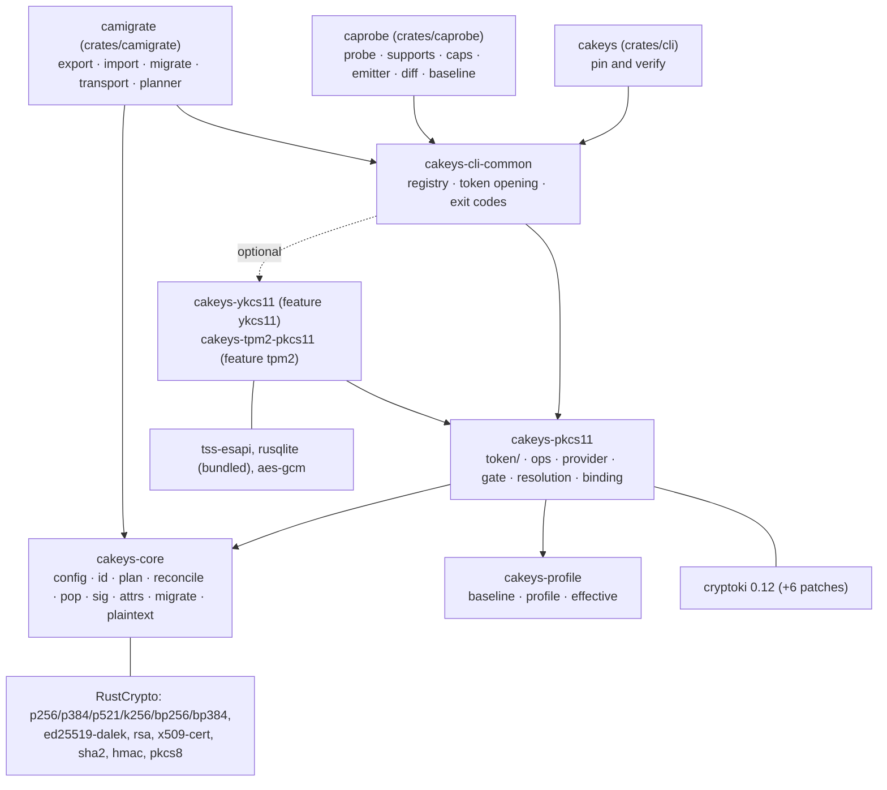
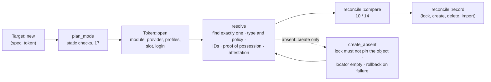

# cakeys: architecture

A map of the repository: where everything lives and how the parts fit. What the identities and
lock rules are is [DESIGN.md](DESIGN.md); each tool's behaviour is in its own document
([CAKEYS.md](CAKEYS.md), [CAPROBE.md](CAPROBE.md), [CAMIGRATE.md](CAMIGRATE.md)).

## Repository map

```text
crates/
  core/         cakeys-core      no token access: config, lock, identity, lock rules, plaintext key parts, the names of moves
  profile/      cakeys-profile   capability profiles as data (no token access)
  pkcs11/       cakeys-pkcs11    cryptoki token layer, verbs, Provider trait, static gate
  ykcs11/       cakeys-ykcs11    YubiKey PIV provider + piv-attestation (pinned Yubico roots)
  tpm2-pkcs11/  cakeys-tpm2-pkcs11  tpm2-pkcs11 provider + native TPM2_Certify attestation, tpm2_ptool import
  kmsp11/       cakeys-kmsp11    Google Cloud KMS provider: keys bound to one algorithm each
  aws-cloudhsm/ cakeys-aws-cloudhsm  AWS CloudHSM provider: Ed25519 through vendor mechanisms
  cli-common/   cakeys-cli-common  what the binaries share: provider registry, opening tokens, exit codes
  cli/          cakeys           pin and verify; the integration-test harness (tests/common)
  caprobe/      caprobe          the module measurer: probe, supports, caps; profile emitter and diff
  camigrate/    camigrate        the key mover: export, import, migrate, transport; the planner
  p11-fault/    p11-fault        a PKCS#11 module that forwards to a real one and misbehaves on request
  p11-names/    p11-names        PKCS#11 names and values from cryptoki-sys (no cakeys dependency)
profiles/       capability profiles: the PKCS#11 3.2 baseline (+ vendored OASIS headers), module
                profiles, layers (cryptoki, p11-kit), hardware (swtpm)
nix/            packages (regular and crane), lib.mkKeys, NixOS module, sandbox hook, VM/module/TPM
                tests, token test environments, demo, fuzz, deny, cryptoki patches
fuzz/           cargo-fuzz targets
examples/       runnable keys.toml examples (every object, TLS, Secure Boot, programs; checks.examples)
                and a real YubiKey secure-boot keys.toml and keys.lock
upstream/       PR drafts for rust-cryptoki, tpm2-pkcs11 and SoftHSM
scripts/        regen-profiles.sh, xversion.sh
docs/           this documentation; docs/archive/ holds dated reviews and working notes
reports/, research_notes/   the lock-format design review and its research
```

Size (2026-11-14): about 19,700 lines of Rust code including tests, 2,900 of Nix and shell, and
1,700 of profile TOML.

## Crates



TPM attestation (`tpm-certify`) stays in `cakeys-tpm2-pkcs11`, behind the `tpm2` feature, and so
with `cakeys`. `cakeys` depends on neither `caprobe` nor `camigrate`, so its build carries no probe or
migration code; `camigrate` records an import through `ops`, the code path `cakeys lock`
uses. `checks.minimal` builds all three without the provider features, and so without tpm2-tss
and sqlite.

| Module | Role |
|---|---|
| `core::config` | `keys.toml` and `keys.lock` types, load and validation, lock invariants, atomic save, the `.lck` advisory lock, `gc` |
| `core::id` | Schemes, canonical SPKI, SRI hashing, commitment inputs, spec digest, attestation encodings |
| `core::plan` | What a (spec, token) pair asks for: identity mode, schemes, binding; static validation (17) |
| `core::reconcile` | The lock rules: `compare` (verdicts, in exit-code order) and `record` (what a write adds) |
| `core::pop`, `core::sig` | Proof-of-possession challenges and host-side verification |
| `core::migrate`, `core::plaintext` | The frozen method and exposure names and the capability model; PKCS#8 into the parts `C_CreateObject` takes |
| `pkcs11::token` | One open token: session, login, SO step, find, policy, generate, identity, possession, host import and extraction, URI |
| `pkcs11::ops` | The verbs: `resolve`, `verify`, `lock`, `create`, `delete`, `check`, and `lock_import` for camigrate |
| `pkcs11::provider` | `Provider` trait, `Registry`, `Generic`, `Data` (providers named by their profiles); the built-in `providers` (p11-kit) |
| `pkcs11::resolution`, `gate`, `binding` | Which profiles apply to a token, the static `validate` gate, the cryptoki layer |
| `profile` | Profile data model, the embedded set, the effective-support algebra |
| `caprobe` | `probe::generate`, `supports`, the profile emitter, the diff, and the test-only baseline generator |
| `camigrate` | The planner (`plan`), each side's capabilities (`tokens`), and the paths: `public`, `sealed`, `host`, `file`, the bundle and the transport file. The CLI only parses, reads and writes files, and prints |

`cakeys-core` and `cakeys-profile` never touch a token, so the lock rules and the profile
algebra are unit- and property-tested without an HSM.

## Control flow

Every verb is: parse arguments → load `keys.toml` and the lock (taking `<lock>.lck` if the run
writes) → open one token → act → print notes, then the result or the error.



| Verb | Binary | Token | Lock |
|---|---|---|---|
| `validate` | `cakeys` | none | read |
| `resolve`, `verify` | `cakeys` | read | read |
| `check` | `cakeys` | read | read |
| `lock` | `cakeys` | read (writes only a missing TPM Attestation Key) | write (default) |
| `create`, `delete` | `cakeys` | write | write (default) |
| `gc` | `cakeys` | none | write with `--apply` |
| `caps`, `supports`, `probe` | `caprobe` | read (`probe --write`: scratch only) | none |
| `export`, `transport` | `camigrate` | read (`transport --trusted`: writes the source as SO) | read |
| `import`, `migrate` | `camigrate` | write the target | write |

## Providers

Module-specific behaviour lives in two places. **Capability profiles** (data,
[CAPROBE.md](CAPROBE.md)) say what a module can do; they filter the mechanism list at token
open and feed `validate`, `supports` and the migration planner. **Providers** (code) rewrite
behaviour or reach outside PKCS#11:

- **Seams** (the `Provider` trait; review 2026-11-15 §4 named the first two): three kinds, and
  nothing else. *Repairs* make a module's answer what a spec-compliant module's would be:
  `repair`, one hook for an attribute read (`CKA_EC_POINT`: tpm2-pkcs11's P-521, aws-cloudhsm's
  Ed25519 SPKI; `CKA_KEY_TYPE`: aws-cloudhsm's Ed25519 as `CKK_EC`; a policy flag: ykcs11's
  `CKA_DERIVE`), and `stand_in`, one for a mechanism (a standard mechanism the module does not
  list but runs its own way, used through `Token::runnable` and relied on only where a profile's
  `add` row says the probe found it working: aws-cloudhsm's Ed25519). *Templates* make cakeys'
  own template for a call one the module takes: `template`, one hook every template cakeys
  builds for `C_GenerateKey(Pair)`, `C_CreateObject`, `C_UnwrapKey` and `C_DeriveKey` passes
  through (`provider::Template` names what it is for: a generation's half, an import by
  `C_CreateObject` or `C_UnwrapKey`, an imported key's public half, a public object, the trusted
  transport copy, or a session key of a proof, a commitment or a move), adjusting it or refusing
  it. Every template is built in one place (`cakeys_pkcs11::templates`) and asked about before
  anything is created: the proof's and the commitments' session keys, which run once the object
  exists, by the capability check before it (`ops::check_templates`, and `ops::check_import`
  before camigrate's imports). A plan asks the same templates without a token (`gate::check`,
  camigrate's plan of every move: `ops::plan_templates`, `tokens::template_refusal`), each
  mechanism name mapped by the profiles' dictionary and each "will this step run" decided by
  the same predicate as the run's from the side's profile; material it has not read (a
  certificate's value, a public key's points) is absent, and what it cannot know (a mechanism
  the profiles do not decide) it does not ask. Secret material is added after the hook, and the
  fallbacks below run on what it returns. The probe's generations (its scratch AES and generic
  secret keys and AES-wrap KEK included), imports, public objects and sealed round trips ask it
  with the verbs' purposes, and a composed move takes camigrate's own KEK templates
  (`tests/template_hook.rs` holds the probe to it). Three kinds of probe template do not pass
  through it, each on purpose: a Montgomery pair's (core has no Montgomery key type to declare
  it by), the unwrap templates `unwrap.refuse` is measured with (the hook filters `Import` by
  that measurement), and the templates a provider already chose whole (`bound_keys`) or that
  are bare by design (the unbound probe). `C_FindObjects` templates do not pass through it. No
  in-tree provider overrides it yet.
  *Operations* a provider may replace
  whole, each default plain PKCS#11 through a public `Token` method an override wraps:
  `create` (`Token::create_declared`; ykcs11 refuses a locator that is not a PIV slot first),
  `destroy` (`Token::destroy_plain`; ykcs11 refuses a key it would not erase), `import_plaintext`
  (tpm2-pkcs11's `tpm2_ptool` import) and `attestation`/`attest` (DESIGN §3.7).
- **Fallbacks every module gets** (not one module's quirk, so in the defaults): a public key the
  module refuses with cakeys' own `CKA_PRIVATE = false` default is made once more without it
  (`with_public_default_dropped`; AWS `CloudHSM`), and an object already gone when its turn
  comes in one `destroy` is destroyed (kmsp11 removes a public half with its private one).
- **Beside them:** `name`, `matches(&ModuleInfo)`, `hint` (error advice), `check_options` (the
  token's `[tokens.<t>.options]`; the default refuses any), and two facts read before acting:
  `manages_as_so` (create and destroy only in an SO session, ykcs11; `Token::managing` runs a
  step that way, camigrate's imports too) and `generation` (create's static half, read by the
  capability gate before any token opens: a module's own template chosen from the spec, refused
  before creating what could not be proven, kmsp11). The probe alone reads `bound_keys` (what it
  generates on a module whose keys are bound to one purpose) and `scratch_occupant` (its
  scratch slot's guard): no operation of the verbs does either. What `stand_in` covers is
  derived from it (`stand_ins`), not declared beside it.
- **Data providers:** a module with none of these needs no code. The family of the module
  profile whose `[match] manufacturer` it reports is its provider (`provider::Data`). softhsm
  and kryoptic are data providers, and keys.toml's `profileDirs` can add more without a rebuild
  (CAPROBE.md).
- **Selection:** an explicit `provider` wins, either a code provider or a profile family; an
  unknown name is exit 17. Otherwise the first registered code provider that matches, then the
  profile family claiming the module's manufacturer, else `generic`. Two families claiming one
  manufacturer are refused (17) until `provider` names one. Registry unit tests:
  `selection_explicit_then_detected_then_generic`, `profiles_name_the_modules_code_does_not_claim`.
- **The fix-up rule:** a hook must return exactly what a spec-compliant module would, so
  identities are portable. That is also why the provider never takes part in an identity: the
  lock records it only as an observation (`observations.<key>.provider`, DESIGN §4.2), where a change warns.

| Provider | Quirks handled or recorded |
|---|---|
| softhsm (data) | none (reference); attests nothing |
| aws-cloudhsm | Ed25519 on a non-FIPS cluster: generated by `CKM_EC_KEY_PAIR_GEN` with the Ed25519 OID and signed by the vendor `CKM_CLOUDHSM_EDDSA` (`stand_in`, the profile's `add` rows), reported `CKK_EC` with the whole SPKI as `CKA_EC_POINT` (both `repair`); it never imports one (`migration.refuses`). Its profiles record the rest: a public key with `CKA_PRIVATE = false` is refused, so `generate` drops that default when it is refused; the AES key wraps it lists are subtracted, so camigrate uses `CKM_RSA_AES_KEY_WRAP` (CAPROBE.md) |
| kmsp11 | keys bound to one Cloud KMS algorithm: `generation` chooses it from the spec (kind and size, `CKA_SIGN` or `CKA_DECRYPT`, `CKA_ALLOWED_MECHANISMS`) under a `CKA_LABEL`-only locator, and refuses what cakeys could not prove (`pop-decrypt`, PSS with `pop-sign`, AES, `CKK_GENERIC_SECRET`); `bound_keys` gives the probe one key per algorithm |
| kryoptic (data) | none to fix (PKCS#11 3.2 reference): Edwards `CKA_EC_POINT` raw (DER with `KRYOPTIC_EC_POINT_ENCODING=DER`; same identity); private keys carry their own `CKA_PUBLIC_KEY_INFO`, so a swapped key is refused (13) by the cross-check before the proof of possession; library version 0.0 in `C_GetInfo`; no secp256k1 or brainpool generation (15); attests nothing |
| ykcs11 | `CKA_PUBLIC_KEY_INFO` length 0 then `CKR_ARGUMENTS_BAD` (tolerated generically); fixed PIV slot IDs and labels: `create` needs a locator of `CKA_ID` alone naming a key slot (`01`–`04`: 9a/9c/9d/9e, `05`–`18`: 82–95; 17 otherwise) and `soCredentialFile`/`soCredentialEnv` (the management key in hex, or the PIN on a PIN-protected-management-key device), since ykcs11 generates only as SO; **keys cannot be deleted** — `C_DestroyObject` clears only the slot's certificate and the key stays, so `delete` (and the cleanup after a failed `lock`) refuses (15), naming `ykman piv keys delete <slot>`; the `piv-attestation` commitment: per-slot attestation certificates found by their label/`CKA_ID`, chain-verified to the embedded Yubico roots (`roots/`, DESIGN §3.7) |
| tpm2-pkcs11 | drops `AES_KEY_GEN`/`GENERIC_SECRET_KEY_GEN` (`C_GenerateKey` unsupported); repairs the malformed P-521 `CKA_EC_POINT` (`04 85 …`; upstream draft in `upstream/tpm2-pkcs11/`) — `tpm2_*` tests; the `tpm-certify` commitment: a native `TPM2_Certify` through tss-esapi and the module's sqlite store (DESIGN §3.7) |
| p11-kit | detects the proxy; the RPC drops AES key wrap and EdDSA/Edwards mechanisms; the module behind it is hidden (set `provider` explicitly) — `p11kit_*` tests; attests nothing itself (what the proxied module exposes decides, but the provider name does not reach it: opt in only against the real module) |

## cryptoki patches

The Nix build patches cryptoki 0.12.1 in `postPatch` (`nix/package-common.nix` lists them, both
the regular and the crane build apply them):

- `cryptoki-hmac-key-types.patch`: cryptoki gives `KeyType::SHA224/384/512_HMAC` the value of
  `CKK_SHA256_HMAC`. Without it those types are refused (`hmac_key_type`), and the binding layer
  subtracts them.
- `cryptoki-aes-key-wrap-kwp.patch`: `CKM_AES_KEY_WRAP_KWP` (kryoptic's RFC 5649 ID).
- `cryptoki-rsa-aes-key-wrap.patch`: `CKM_RSA_AES_KEY_WRAP` and its parameters (`enforced` moves).
- `cryptoki-sign-after-init.patch`: a single-part `C_Sign` in an operation `C_SignInit` started,
  for a `CKA_ALWAYS_AUTHENTICATE` key's per-use login.
- `cryptoki-allowed-mechanisms-unnamed.patch`: a `CKA_ALLOWED_MECHANISMS` entry cryptoki has no
  name for kept as its value.
- `upstream/rust-cryptoki/0003-Add-RvError-to-CK_RV-and-its-name.patch`, the upstream draft
  itself: an `RvError` back to its `CK_RV`, and its `CKR_*` name, for a module failure's value
  (`KmError::rv`) and the name messages and profile evidence give it.

What only the patched cryptoki compiles sits behind a feature the Nix build turns on: camigrate's
and caprobe's `kwp` (the two wrap mechanisms), `cakeys-pkcs11/sign-after-init` and
`cakeys-pkcs11/rv-value`. A plain cargo build plans without the wraps, refuses a per-use-login
proof, and names a failure without carrying its value. Upstream drafts: `upstream/rust-cryptoki/`.

## Dependencies

Policy: the latest release of everything, audited on every dependency change against crates.io
and the flake inputs. Pinned on purpose: none, beyond the local patches above. `pkcs12` 0.2 and
`cms` 0.3 are release candidates of the RustCrypto line `der` 0.8 and `x509-cert` 0.3 belong
to. Edition 2024, `rust-version = 1.89`; Nix builds with the nixpkgs rustc.

The flake serves x86_64-linux, aarch64-linux and aarch64-darwin. Darwin builds the tools without
the `tpm2` feature (no tpm2-tss there; `withTpm2` in `nix/package-common.nix`, which also builds
that configuration on Linux) and has no NixOS tests, PC/SC sandbox probe or fuzz smoke run.
