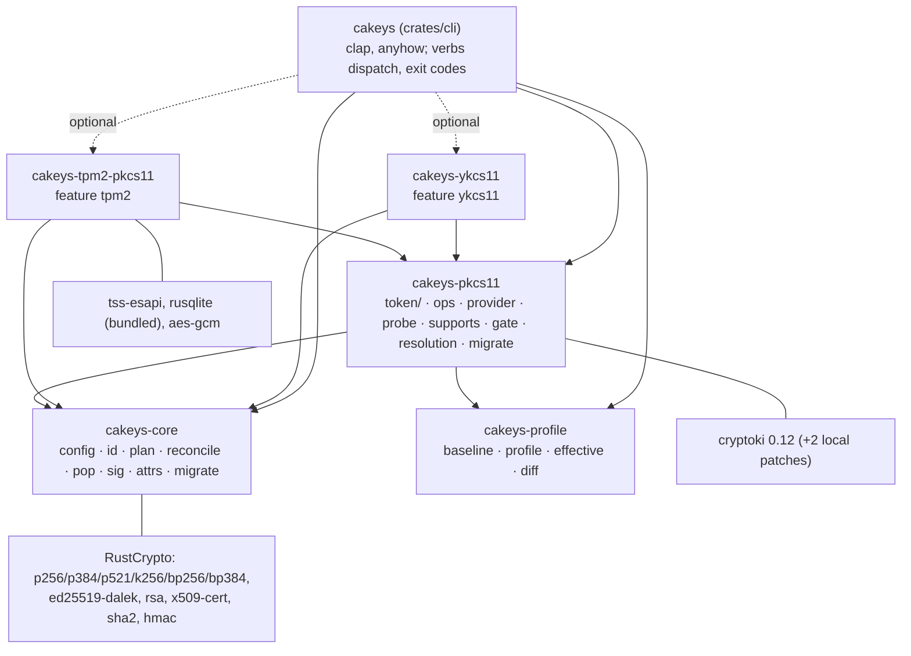
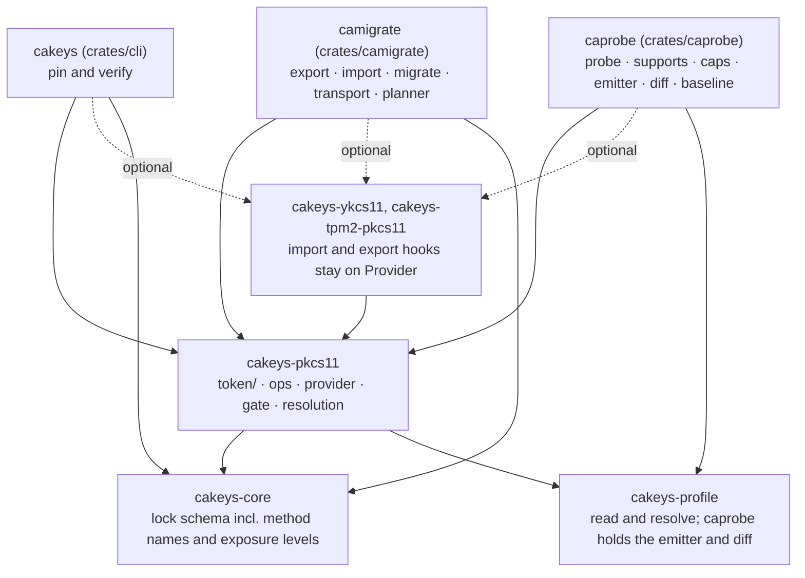
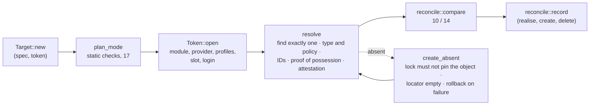

# cakeys: project map and architecture (2026-11-13, at 6b91684)

A map of the whole repository: what the project is for, where everything lives, how the parts
fit, and what state each part is in. [`DESIGN.md`](DESIGN.md) stays the authoritative
description of behaviour (schemes, lock rules, exit codes); this page is the overview that
points into it. The review made alongside this map is
[`REVIEW-2026-11-13.md`](REVIEW-2026-11-13.md).

## 1. What it is

cakeys pins **what key material a token holds** and checks it before use.

- Objects on a PKCS#11 token (keys, certificates, data) are declared in `keys.toml`.
- Each is identified by a hash of its material (a CA-ID), recorded in `keys.lock`. Labels,
  `CKA_ID`s and URIs only *locate* an object; they are never its identity.
- Every verb recomputes the identity from the live token and compares it with the lock. A
  private key also proves possession of the key its identity names.
- In Nix, a derivation runs `cakeys check` before using the key, and a NixOS module gives the
  build sandbox access to a token only when the derivation asks for that token.

Status: proof of concept, three days old (148 commits, 2026-11-11 to 2026-11-13), x86_64-linux
only, lock format `version = 1` still a draft.

## 2. Scope

[`SCOPE.md`](SCOPE.md) is the full statement. In short:

| | |
|---|---|
| **Core** | The lock file and its rules; identity schemes; verify before use; the CLI and its exit codes; the Nix library and NixOS module; tests against reference tokens |
| **Provider crates only** | Vendor quirks and fix-ups, vendor attestation, vendor tools and native libraries |
| **Planned, partly built** | Export and import of key material ([`MIGRATE.md`](../MIGRATE.md): only the planner and `--dry-run` exist); FIPS-mode requirements (PROVIDERS D12) |
| **Open questions** | A stable library API or C ABI ([`CONTRACT.md`](CONTRACT.md)); signing the lock; changing an object's policy; lock merge rules |
| **Out** | Crypto implementations, key generation on the host, rotation and approval policy, storing secrets or PINs, being a PKCS#11 module, CA work, proving a key exists nowhere else |

What the tool defends against is not written down anywhere as a threat model; see the review
(A1) for the one inferred from the code.

## 3. Repository map

```text
crates/
  core/         cakeys-core      no token access: config, lock, identity, lock rules, the names of moves
  profile/      cakeys-profile   capability profiles as data (no token access)
  pkcs11/       cakeys-pkcs11    cryptoki token layer, verbs, Provider trait, static gate
  ykcs11/       cakeys-ykcs11    YubiKey PIV provider + piv-attestation (pinned Yubico roots)
  tpm2-pkcs11/  cakeys-tpm2-pkcs11  tpm2-pkcs11 provider + native TPM2_Certify attestation
  cli-common/   cakeys-cli-common  what the binaries share: provider registry, opening tokens, exit codes
  cli/          cakeys           clap CLI as a library (main(registry)); the integration-test harness (tests/common)
  caprobe/      caprobe          the module measurer: probe, supports, caps; profile emitter and diff
  camigrate/    camigrate        the key mover: export, migrate, transport; the migrate planner
profiles/       capability profile data: PKCS#11 3.2 baseline (+ vendored OASIS headers),
                module profiles (softhsm, kryoptic, ykcs11, tpm2-pkcs11), layers (cryptoki, p11-kit), hardware (swtpm)
nix/            package, lib.mkKeys, NixOS module, sandbox hook, VM/module/TPM tests, demo, fuzz, deny
fuzz/           cargo-fuzz targets: public_key, certificate, lock, config
examples/       a real YubiKey secure-boot keys.toml and keys.lock
upstream/       patches and PR drafts for rust-cryptoki and tpm2-pkcs11
scripts/        xversion.sh: cross-version lock compatibility check
docs/           design and reference documentation (section 9)
reports/, research_notes/   the lock-format design review and its research
docs/working/   working notes: CHECKPOINT, WORK, ISSUES, RESPONSE (section 9)
*.md (root)     README, PLAN, NEXT, MIGRATE (section 9); WORKPLAN, the order of the current work
flake.nix, checks.nix, treefmt.nix, deny.toml
```

Size, Rust code lines (tokei, inline tests included):

| Area | Lines | Share |
|---|---:|---:|
| Pin and verify: `core` (less migrate), `pkcs11` token layer, `ops`, `provider` | ≈ 5,000 | 50% |
| Capability profiles: `profile` crate, `probe`, `supports`, `resolution`, `gate`, `binding` | ≈ 2,100 | 21% |
| Attestation: `tpm2-pkcs11`, `ykcs11` | ≈ 1,350 | 14% |
| Migration planner: `camigrate` (`plan`, `tokens`, `transport`) | ≈ 1,000 | 10% |
| CLI (arguments, files, printing) | ≈ 600 | 6% |
| Integration and property tests (`crates/*/tests`) | ≈ 4,300 | — |

Plus about 1,900 lines of Nix, 1,400 lines of profile TOML and 8,000 lines of Markdown.

## 4. Crates and dependencies



| Module | Role |
|---|---|
| `core::config` | `keys.toml` and `keys.lock` types, load and validation, lock invariants, atomic save, the `.lck` advisory lock, `gc` |
| `core::id` | Schemes, canonical SPKI, SRI hashing, commitment inputs, spec digest, attestation encodings |
| `core::plan` | What a (spec, token) pair asks for: identity mode, schemes, binding; static validation (exit 17) |
| `core::reconcile` | The lock rules: `compare` (verdicts, in exit-code order) and `record` (what a write adds) |
| `core::pop`, `core::sig` | Proof-of-possession challenge and host-side verification |
| `pkcs11::token` | One open token: session, login, SO step, find, policy, generate, identity, possession, URI |
| `pkcs11::ops` | The verbs: `resolve`, `verify`, `realise`, `create` (one pair) and `create_selected` (the verb's loop over pairs), `delete`, `check` |
| `camigrate` | `tokens::plan_moves` and `transport`, the logic of the `export`/`migrate` and `transport` verbs over the pure planner (`plan`); the CLI only parses, reads and writes files, and prints (review A11) |
| `pkcs11::provider` | `Provider` trait, `Registry`, `Generic`; built-ins in `providers` (softhsm, kryoptic, p11-kit) |
| `pkcs11::resolution`, `gate`, `binding` | Capability profiles: which apply to a token, the static `validate` gate, the cryptoki layer |
| `profile` | Profile data model, the embedded set, the effective-support algebra |
| `caprobe` | `probe::generate` and `supports::supports`, the logic of the `probe` and `supports` verbs; the profile emitter (`emit`), the diff, and the test-only baseline generator |

`cakeys-core` and `cakeys-profile` never touch a token, so the lock rules and the profile
algebra are unit- and property-tested without an HSM.

**Crate map with `caprobe` and `camigrate` (built, WORKPLAN stages 2 and 3).** The
graph above is the one before the split; after it:



| Change | Stage |
|---|---|
| `pkcs11::probe`, `pkcs11::supports`, the `caps` verb and their argument parsing move to `caprobe` | 2 (done) |
| `cakeys-profile`'s emitter, `diff` and baseline generator move into `caprobe` | 2 (done) |
| What the probe uses from the token layer becomes public `cakeys-pkcs11` API | 2 (done) |
| The provider registry moves out of the `cakeys` CLI crate to where all three binaries share it | 2 (done) |
| `OaepHash` moves out of `core::migrate` to a neutral module, so `caprobe` needs no migration code | 2 (done) |
| `core::migrate`'s planner, `pkcs11::migrate` and the `export`, `migrate` and `transport` verbs move to `camigrate` | 3 (done) |
| `cakeys` depends on neither new crate; `camigrate` records an import through `ops`, the code `cakeys realise` uses | 3 (done) |

## 5. Data model

Three levels ([`DESIGN.md`](DESIGN.md) §2, drawn in [`diagrams.md`](diagrams.md) §1):

| Level | In `keys.toml` | In `keys.lock` |
|---|---|---|
| **Object**: the material and its type | `[objects.<name>]` | `[objects.<name>]`: `type`, `ids` (scheme → SRI), `commitmentLabel`, `pairs` |
| **Spec**: policy for one use of an object | `[specs.<name>]`: `attributes`, `publicAttributes` | spec digest, inside each realisation |
| **Realisation**: a spec on one token | `specs.<name>.tokens.<token>`: locator, `autoCreate`, `publicOnly`, `binding`, `attestation` | `[realisations.<spec>.<token>]`: compared fields, `observed`, `provenance` |

Tokens are declared once in `[tokens.<name>]` (module path, token label, PIN source, provider,
provider options). The lock has no token table: what it knows about a token is repeated in
every realisation on it (review A3).

Identity schemes ([`DESIGN.md`](DESIGN.md) §3.1):

| Class | Schemes | How |
|---|---|---|
| Private and public keys | `rfc7093m4` | SHA-256 of the canonical SPKI, re-encoded on the host |
| Certificates | `certhash`, `rfc7093m4` | SHA-256 of the DER; the subject key's hash |
| Data objects | `valuehash` | SHA-256 of `CKA_VALUE` |
| Secret keys | `commitment`, `cmac`, `kcv-ecb`, `kcv-ecb-dec`, `kw` | SHA-256 of what the token computes over a fixed public label |
| Per device, opt-in | `piv-attestation`, `tpm-certify` | Digest of vendor- or TPM-signed claims; stored on the realisation, never as the object's ID |

Lock rules, in one paragraph: a write only adds IDs, it never changes one; material is linked
across tokens only through a scheme both compute; mode, binding, schemes, attestation and the
creation-time immutables may never weaken; a realisation record is required before `verify`
passes; `observed` and `provenance` never change a verdict.

## 6. Control flow

Every verb is: parse arguments → load `keys.toml` and the lock (taking `<lock>.lck` if the run
writes) → open one token → act → print notes, then the result or the error.



The binary column is each verb's owner ([`SCOPE.md`](SCOPE.md), "Three tools").

| Verb | Binary | Token | Lock | Summary |
|---|---|---|---|---|
| `validate` | `cakeys` | none | read | Static checks, then each spec's needs against its token's capability profiles |
| `resolve` | `cakeys` | read | read | Find, check, compute IDs, print JSON |
| `verify` | `cakeys` | read | read | `resolve` + compare; prints the URI |
| `check` | `cakeys` | read, or write with `autoCreate` | read | Pre-use check by object name: `realise` without the write |
| `realise` | `cakeys` | write | write (default) | Adopt, or create with `autoCreate`; compare; record |
| `create` | `cakeys` | write | write (default) | Generate every unpinned key, `autoCreate` or not |
| `delete` | `cakeys` | write | write (default) | Delete if the identity matches; drop the realisation |
| `gc` | `cakeys` | none | write with `--apply` | Drop lock entries the config no longer names |
| `caps`, `supports`, `probe` | `caprobe` | read (`probe --write`: scratch token only) | none | Mechanisms; profile queries; profile generation and drift |
| `export`, `migrate`, `transport` | `camigrate` | read | read | Plans only (`--dry-run`); nothing moves yet |
| `import` | `camigrate` (planned, stage 4) | write | write | Not built yet (MIGRATE.md phase 3) |

Exit codes are the error model: 10 hash mismatch, 11 not found, 12 ambiguous, 13 conflict,
14 precondition failed, 15 unsupported, 16 unavailable, 17 invalid input, 1 I/O, 2 usage.

## 7. Module-specific behaviour: two mechanisms

1. **`Provider` trait** (code). Selected by `provider = "..."` or detected from `C_GetInfo`.
   Hooks rewrite or reach outside PKCS#11: `ec_point` (tpm2 P-521 repair), `check_options`,
   `manages_as_so` / `check_create` / `keeps_destroyed_keys` (ykcs11), `attestation` /
   `attest`. The rule: a fix-up returns exactly what a compliant module would, so identities
   stay portable.
2. **Capability profiles** (data, [`PROVIDERS.md`](PROVIDERS.md)). A baseline generated from
   the PKCS#11 3.2 headers; one observed profile per module version; delta layers for what sits
   between cakeys and the module (cryptoki build, p11-kit, hardware). They filter the
   mechanism list at token open, feed `validate`, `supports` and the migrate planner, and are
   produced and re-checked by `probe`.

**Not yet fully used.** The two overlap today: `Provider::mechanisms` and
`Provider::migration` are overridden by no in-tree provider (profiles answer both), and the
profile machinery is larger than its current consumers need. Both are kept on purpose for
real-world HSM providers; revisit when the first one lands (review A4).

Attestation is the largest provider code: ykcs11 verifies the slot certificate chain to
embedded Yubico roots; tpm2-pkcs11 reads the module's sqlite store, loads the key over its own
TCTI and runs `TPM2_Certify` against an Attestation Key it provisions.

## 8. Nix integration

| Part | File | What it does |
|---|---|---|
| `lib.mkKeys` | `nix/lib.nix` | Builtins-only view of `keys.toml` + `keys.lock`: each object is a function returning `id`, `uri`, `type`, `functions`, `requiredSystemFeatures` and the `check` command string |
| NixOS module | `nix/module.nix` | `services.cakeys.tokens` (system feature, sandbox paths, pcscd), `sandbox.{pcscd,tpm2,uidRange}`, `checks.<name>` oneshot units that gate services |
| Sandbox hook | `nix/sandbox-hook.sh` | `pre-build-hook`: grants a token's paths only to derivations whose `requiredSystemFeatures` name its feature; always exits 0 |
| Package | `nix/package.nix` | Builds with the two cryptoki patches; runs the SoftHSM, kryoptic, tpm2 (swtpm) and p11-kit suites in `checkPhase` |
| Checks | `checks.nix` | `vm`, `module`, `tpm`, `lib`, `profiles`, `demo`, `fuzz`, `deny`, `clippy`, `minimal`, `formatting` |

The consumer pattern: `uri=$(${key.check})` at the top of a build that sets
`requiredSystemFeatures = key.requiredSystemFeatures`. Real builds reach a token through a
p11-kit socket or `/dev/tpmrm0`, never a token database.

## 9. Documentation map

| File | Kind | Content |
|---|---|---|
| `README.md` | entry | Overview, example, verbs, Nix usage, development commands |
| `docs/DESIGN.md` | **authoritative** | Model, schemes, files, verbs, providers, Nix, security model, tests, frozen identifiers |
| `docs/SCOPE.md` | reference | In, provider-only, possible, minimal, out |
| `docs/USE_CASE.md` | reference | Problems solved, questions answered, two open items |
| `docs/CONFIG.md`, `docs/LOCK.md` | reference | The two files, annotated |
| `docs/diagrams.md` | reference | Mermaid diagrams of the model, verbs and Nix loop |
| `docs/CKA_ALWAYS_AUTHENTICATE.md` | reference | The per-use PIN proof |
| `docs/VERIFICATION.md` | plan | Where bugs came from; fuzzing, property tests, models |
| `docs/PROVIDERS.md`, `docs/PROVIDER_PROFILE.md` | plan + results | Capability profiles, phases 0–4 done, 5 planned |
| `MIGRATE.md` | plan + results | Export and import; phases 0–1 done |
| `docs/CONTRACT.md` | proposal | Keys as a declared resource for other languages |
| `docs/REVIEW-2026-11-11.md`, `docs/REVIEW-2026-11-13.md` | review registers | Findings and status |
| `docs/REFACTOR-2026-11-12.md` | history | The R0–R11 refactor and its outcome |
| `PLAN.md` | history + backlog | Original plan, prior art, decisions, deferred to-dos |
| `NEXT.md` | roadmap | What is next, in order |
| `docs/working/{CHECKPOINT,WORK,ISSUES,RESPONSE}.md` | working notes | Session state, in-progress notes, an earlier review, the first design Q&A |
| `reports/`, `research_notes/` | research | Lock-format design review and prior art |

## 10. Testing

| Layer | Where |
|---|---|
| Unit and known-answer tests (pinned digests, scheme definitions, lock rules) | inline, `cargo test --workspace` |
| Property tests of the lock rules and parsers | `crates/core/tests/properties.rs` |
| One shared suite on SoftHSM and kryoptic | `crates/cli/tests/{softhsm,kryoptic}.rs`, `tests/reference/` |
| Cross-token: one identity per scheme everywhere | `crates/cli/tests/references.rs` |
| tpm2-pkcs11 on swtpm; SoftHSM behind p11-kit | `tests/tpm2.rs`, `tests/p11kit.rs` |
| Real YubiKey, opt-in, never in CI | `tests/yubikey.rs` |
| NixOS VM: CLI flow, sandboxed consumer, module, hook, TPM ACL | `nix/test.nix`, `nix/module-test.nix`, `nix/tpm-test.nix` |
| Fuzzing (4 parsers), cargo-deny, clippy pedantic, minimal build | `checks.nix` |

The integration suites drive the built CLI against real software tokens and check results
against independent oracles (openssl, hand-written DER, RustCrypto MACs).

## 11. State of each part

| Part | State |
|---|---|
| Identity, lock rules, verbs, proof of possession | Built and tested on four module families |
| Nix library, NixOS module, sandbox hook | Built, VM-tested |
| `piv-attestation` | Built; verified by hand on one YubiKey 5C NFC FIPS |
| Three binaries (`cakeys`, `caprobe`, `camigrate`) | Built ([`WORKPLAN.md`](../WORKPLAN.md) D1–D6, stages 2 and 3), one Nix output each |
| `tpm-certify` | Built; tested on swtpm; Attestation Key is trust-on-first-use (no EK chain). Experimental, pending review: it reads tpm2-pkcs11's private store and has no version guard yet (review A8). Stays in `cakeys-tpm2-pkcs11` (WORKPLAN D4); the guard and a real-TPM test are planned for WORKPLAN stage 5 |
| Capability profiles | Phases 0–4 built; phase 5 (FIPS mode) planned. Measuring is `caprobe`'s (WORKPLAN stage 2); `cakeys` reads and resolves them |
| Migration | In scope, in `camigrate` (review A5, decided; WORKPLAN stage 3). Planner and `--dry-run` only; phases 2–5 planned for stage 4 |
| `check` creating on first use (`autoCreate`) | Built; open decision whether to keep it (review A7) |
| Identity modes `commit-at-creation`, `host-at-import`, `token-specific`; `identity.allow` | Pending implementation: in the config schema, refused (15) by every verb (review A6) |
| `systemFeature` | Declared in both keys.toml and the NixOS module, kept equal by hand; one owner pending (review A6) |
| Lock format | `version = 1`, draft, changes in place. The observation table (review A3), the resolved profile name and `provenance.origin` landed together (WORKPLAN stage 1) |
| Platforms | x86_64-linux only |
