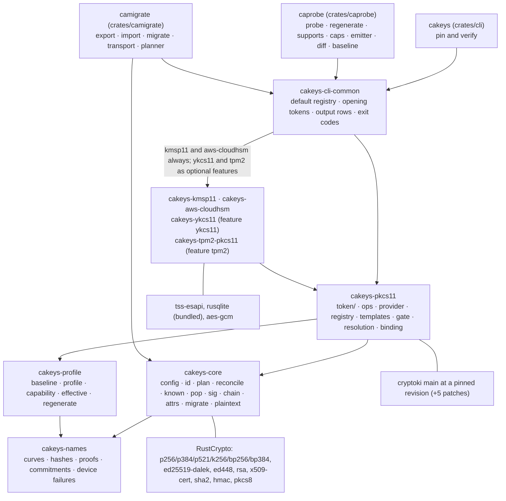
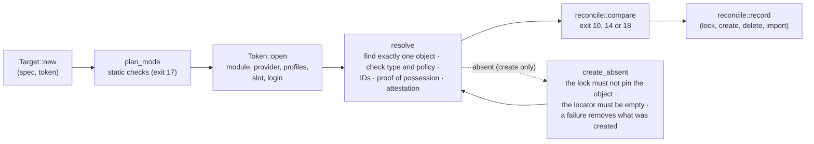

# cakeys: architecture

This document is a map of the repository. It shows where each part lives and how the parts work
together. [DESIGN.md](DESIGN.md) defines the identities and the lock rules. Each tool's behavior
is described in its own document: [CAKEYS.md](CAKEYS.md), [CAPROBE.md](CAPROBE.md) and
[CAMIGRATE.md](CAMIGRATE.md).

## Repository map

```text
crates/
  core/         cakeys-core      the code that needs no token: the config, the lock, the identities, the lock rules, the parts of a plaintext key, and the names of the methods that move keys
  names/        cakeys-names     the tables that core and the profiles share: curves, hashes, proofs, commitments, and the return values that mean the device failed (no dependencies)
  profile/      cakeys-profile   the capability profiles as data (no token access)
  pkcs11/       cakeys-pkcs11    the token layer over cryptoki, the verbs, the Provider trait, the templates, the provider registry, and the static gate
  ykcs11/       cakeys-ykcs11    the YubiKey PIV provider and the piv-attestation scheme (with the pinned Yubico roots)
  tpm2-pkcs11/  cakeys-tpm2-pkcs11  the tpm2-pkcs11 provider, the TPM2_Certify attestation (through the module's vendor mechanism or natively), and the tpm2_ptool import
  kmsp11/       cakeys-kmsp11    the Google Cloud KMS provider, whose keys are each bound to one algorithm
  aws-cloudhsm/ cakeys-aws-cloudhsm  the AWS CloudHSM provider, which runs Ed25519 through vendor mechanisms
  cli-common/   cakeys-cli-common  the code that the three binaries share: the default provider registry, the opening of tokens, the output row of each pair, and the exit codes
  cli/          cakeys           the tool that pins and verifies keys, and the integration-test harness (tests/common)
  caprobe/      caprobe          the tool that measures modules: probe, regenerate, supports and caps, the profile emitter, and the diff
  camigrate/    camigrate        the tool that moves keys: export, import, migrate and transport, and the planner
  p11-fault/    p11-fault        a PKCS#11 module that forwards each call to a real module and injects faults on request
  p11-names/    p11-names        the PKCS#11 names and values from cryptoki-sys (no dependency on cakeys)
  pin-roots.rs, test-skip.rs     source files that several crates include: the providers' build-time check of the pinned roots, and the one way a test skips
profiles/       the capability profiles: the PKCS#11 3.2 baseline (with the vendored OASIS headers), the module
                profiles, the layers (cryptoki, p11-kit), the hardware (swtpm), and LEDGER.toml (what was
                measured on hardware)
nix/            the crane package, lib.mkKeys, the NixOS module, the sandbox hook, the VM, module and TPM tests,
                the token test environments, the demo, fuzzing, Kani, cargo-deny, the cryptoki patches, the cloud
                HSM libraries, and the repository's own checks (doc references, claims, ledger, golden rows, test
                and oracle counts, mutation gate)
fuzz/           the cargo-fuzz targets
examples/       runnable keys.toml examples (every object, TLS, Secure Boot, programs, and a key injected into a
                program's open; checks.examples), and a real keys.toml and keys.lock for YubiKey Secure Boot
spec-coverage/  the status of every row of the PKCS#11 baseline (cakeys.toml, generated), the hand-kept rules
                (manual.toml), and the object matrix (objects/)
upstream/       the drafts of pull requests for rust-cryptoki, tpm2-pkcs11 and SoftHSM
scripts/        regen-profiles.sh, xversion.sh, local-tests.sh, the coverage, mutation, badge and pkcs11-check
                scripts, yubikey-empty-slots.py, and the cloud test beds (cloud/)
docs/           this documentation; docs/archive/ holds the dated reviews and plans that are still cited
reports/, research_notes/   the design review of the lock format, and its research
```

On 2026-11-14, the repository held about 19,700 lines of Rust code (tests included), 2,900 lines
of Nix and shell, and 1,700 lines of profile TOML.

## Crates



The TPM attestation (`tpm-certify`) lives in `cakeys-tpm2-pkcs11` behind the `tpm2` feature, so
the `cakeys` binary contains it when that feature is on. `cakeys` depends on neither `caprobe` nor
`camigrate`, so its build contains no probe code and no migration code. `camigrate` records an
import through `ops`, which is the same code path that `cakeys lock` uses. `checks.minimal`
builds all three tools without the optional provider features (`tpm2` and `ykcs11`), and
therefore without tpm2-tss and sqlite.

| Module | Role |
|---|---|
| `core::config` | The types of `keys.toml` and `keys.lock`, their loading and validation, the lock's invariants, the atomic save, the `.lck` advisory lock, and `gc`. |
| `core::id` | The identity schemes, the canonical SPKI, the SRI hashing, the inputs of the commitments, the spec digest, and the encodings of the attestations. |
| `core::plan` | What a (spec, token) pair requires: the identity mode, the schemes and the binding. It also holds the static validation, which refuses with exit 17. |
| `core::reconcile` | The lock rules. `compare` returns the verdicts in the order that decides the exit code, and `record` writes into the lock what the run found: the object's type, the commitment label, the missing IDs, the realisation, and the pairs. |
| `core::known` | What is known about a security attribute, and the reason when it is not known. An unknown restriction restricts, and an unknown permission does not permit. |
| `core::pop`, `core::sig` | The challenges of the proofs of possession, and their verification on the host. |
| `core::chain` | The verification of X.509 attestation chains on the host, up to pinned anchors. The YubiKey PIV attestation and the TPM's EK certificate both use it. |
| `core::migrate`, `core::plaintext` | `core::migrate` holds the frozen names of the methods, the exposure levels and the OAEP hashes. `core::plaintext` parses a PKCS#8 key into the parts that `C_CreateObject` takes. |
| `pkcs11::token` | One open token: the session, the login, the SO step, the search, the policy, the generation, the identity, the proof of possession, the import and extraction through the host, and the URI. |
| `pkcs11::ops` | The verbs: `resolve`, `lock`, `create`, `delete`, `check` (implemented as `verify`), and `lock_import`, which camigrate uses. Its submodules hold the named rules that a pair must pass before a write (`rules`, with `static_rules`), the capability checks (`capabilities`), the identity check of a key on the host (`identity`), and the create planner (`planner`). |
| `pkcs11::provider`, `registry`, `chain_time` | `provider` holds the `Provider` trait, `Generic`, and `Data` (the providers that their profiles name). The built-in provider for p11-kit is in `providers`. `registry` holds the `Registry` of providers, and `chain_time` holds the policy for the dates of certificates. |
| `pkcs11::templates` | The templates that cakeys builds from what it knows before the call. The run sends these templates, and a plan asks the provider about the same templates before anything runs. |
| `pkcs11::resolution`, `gate`, `binding` | `resolution` decides which profiles apply to a token. `gate` is the static gate that `validate` runs. `binding` is the capability layer of the cryptoki binding (what an unpatched binding subtracts). |
| `profile` | The data model of the profiles, the embedded set of profiles, the algebra that computes the effective support, and the writer of regenerated golden files (`regenerate`). |
| `caprobe` | `probe::generate`, `supports`, the profile emitter, the diff, and two generators that only the tests run: the generator of the baseline and the generator of the coverage file. |
| `camigrate` | The planner: the choice of method (`plan`), the capabilities of each side (`side`, `tokens`), and the rules that apply after the choice of method (`landing`: what keeps an object on its token, which pair a move lands on, and what a bundle or a key file can carry). The values that a file claims, and the transport key that the lock binds to the target (`trust`). The paths: `public`, `sealed`, `host`, `file`, the bundle, and the transport file. The CLI (`lib.rs`, `file_verbs.rs`) parses the arguments, routes the verbs, reads and writes the files, and prints the results. |

`cakeys-core` and `cakeys-profile` never access a token. The lock rules and the profile algebra
therefore have unit tests and property tests that run without an HSM.

## Control flow

A verb runs these steps in order. It parses the arguments, and it loads `keys.toml` and the lock
(it also takes `<lock>.lck` if the run writes). It then opens a token, acts, and prints the notes
followed by the result or the error. The table below the diagram shows which verbs open no token
and which verbs write.



| Verb | Binary | Token | Lock |
|---|---|---|---|
| `validate` | `cakeys` | none | read |
| `resolve` | `cakeys` | read | read |
| `check` | `cakeys` | read | read |
| `lock` | `cakeys` | read (it writes only a missing TPM Attestation Key) | write (default) |
| `create`, `delete` | `cakeys` | write | write (default) |
| `gc` | `cakeys` | none | write (read with `--dry-run`) |
| `caps`, `supports`, `probe`, `regenerate` | `caprobe` | read (`probe --write-probes` and `regenerate` write only scratch objects) | none |
| `export`, `transport` | `camigrate` | read (`transport --trust-on` writes to the source as SO) | read |
| `import`, `migrate` | `camigrate` | write (to the target) | write |

## Providers

The behavior that is specific to one module lives in two places. **Capability profiles** are
data ([CAPROBE.md](CAPROBE.md)) that state what a module can do. When a token opens, its profiles
filter the mechanism list, and `validate`, `supports` and the migration planner read them.
**Providers** are code that changes how cakeys works with a module or that reaches outside
PKCS#11:

- **Seams** are the `Provider` methods that change how cakeys works with a module. There are
  three kinds of seam and no others (review 2026-11-15 §4 named the first two kinds).
  - *Repairs* change a module's answer into the answer that a spec-compliant module would give.
    There is one typed hook for each attribute read. `ec_point` repairs tpm2-pkcs11's P-521 point
    and aws-cloudhsm's Ed25519 SPKI. `key_type` repairs aws-cloudhsm's Ed25519 key, which the
    module reports as `CKK_EC`. `policy_flag` repairs ykcs11's `CKA_DERIVE`. cakeys calls
    `policy_flag` only for the (attribute, private key type) pairs that the provider's `repairs`
    declares, so no repair can widen a permission that it does not name (review 2026-11-24 B-3).
    One more repair, `stand_in`, covers a mechanism: a standard mechanism that the module does
    not list but runs in its own way. cakeys uses a stand-in through `Token::runnable`, and it
    relies on the stand-in only where a profile's `add` row records that the probe found it
    working. aws-cloudhsm's Ed25519 is the one case.
  - *Templates* change cakeys' own template for a call into a template that the module accepts.
    One hook, `template`, does this. Every template that cakeys builds for
    `C_GenerateKey(Pair)`, `C_CreateObject`, `C_UnwrapKey` and `C_DeriveKey` passes through it,
    and the hook may adjust the template or refuse it. `provider::Template` names what each
    template is for: one half of a generated key, an import by `C_CreateObject` or
    `C_UnwrapKey`, the public half of an imported key, a public object, the trusted copy of a
    transport key, or a session key of a proof, a commitment or a move.

    cakeys checks what the hook returns (`adjusted`). The security attributes are the ones in
    `provider::SECURITY`: `CKA_TOKEN`, `CKA_PRIVATE`, `CKA_SENSITIVE`, `CKA_EXTRACTABLE`,
    `CKA_WRAP_WITH_TRUSTED`, `CKA_TRUSTED`, `CKA_ID`, `CKA_LABEL`, `CKA_MODIFIABLE`,
    `CKA_COPYABLE` and `CKA_DESTROYABLE`. If the hook changes, adds or removes one of them,
    cakeys refuses the template with exit 17, unless the change tightens the attribute: it sets
    a restriction to true or a permission to false. Before this check, a provider could undo
    the sealing of a session key, and nothing noticed, because cakeys never reads a session key
    back (review 2026-11-24 B-3). The template of a session key now has its own type
    (`templates::SessionTemplate`). The builder sets its sealing, and material is added beside
    the sealing attributes (`with_material`), never over them.

    Every template is built in one module (`cakeys_pkcs11::templates`), and cakeys asks the
    hook about each template before it creates anything. The session keys of the proof and of
    the commitments are used only after the object exists, so the capability check asks about
    their templates before the object is created (`ops::check_templates`, and
    `ops::check_import` before camigrate's imports). A plan asks about the same templates
    without a token (`gate::check`, and camigrate's plan of every move: `ops::plan_templates`,
    `tokens::template_refusal`). The plan maps each mechanism name through the profiles'
    dictionary. It decides whether each step will run with the same predicate that the run
    uses, applied to the profile of that side. Material that the plan has not read (the value
    of a certificate, the points of a public key) is absent from its templates. The plan does
    not ask about what it cannot know (a mechanism that the profiles do not decide).

    Secret material is added after the hook runs, and the fallbacks below work on the template
    that the hook returns. The probe asks the hook too, with the same purposes as the verbs,
    about its generations (including its scratch AES keys, its scratch generic secret keys and
    its AES-wrap KEK), its imports, its public objects and its sealed round trips. A composed
    move uses camigrate's own KEK templates. `tests/template_hook.rs` checks that the probe asks
    the hook. Three kinds of probe template do not pass through the hook, each on purpose. The
    first is the template of a Montgomery key pair, because core has no Montgomery key type to
    declare it with. The second is the unwrap templates that measure `unwrap.refuse`, because
    the `Import` templates that reach the hook are already filtered by that
    measurement. The third is the templates that a
    provider already chose whole (`bound_keys`) and the templates that are bare by design (the
    unbound probe). `C_FindObjects` templates do not pass through the hook either. No in-tree
    provider overrides the hook yet.
  - *Operations* are methods that a provider may replace whole. Each default is plain PKCS#11
    through a public `Token` method, which an override can wrap. `create` (default
    `Token::create_declared`) and `destroy` (default `Token::destroy_plain`) are called only by
    the token. Before a creation the token asks `placement`, and before a destroy it asks
    `deletion`. It then enters the SO session that `manages_as_so` asks for, and it hands the
    override a `Checked` request that no other crate can build, so an override can skip neither
    step (review 2026-11-24 B-2). `plaintext_import` returns the kind of import together with
    its tool (tpm2-pkcs11's `tpm2_ptool` import). `attestation` returns the attestation
    capability together with its computation (DESIGN §3.7).
- **Fallbacks for every module:** these handle behavior that is not one module's quirk, so they
  are part of the defaults. When a module refuses a public key with cakeys' own
  `CKA_PRIVATE = false` default, cakeys makes the key once more without that default
  (`with_public_default_dropped`; AWS `CloudHSM` needs this). When one `destroy` call removes
  several objects and an object is already gone when its turn comes, cakeys counts it as
  destroyed (kmsp11 removes a public half together with its private key).
- **Other methods:** the trait also has `name`, `matches(&ModuleInfo)`, `hint` (advice added to
  an error), and `check_options` (which checks the token's `[tokens.<t>.options]`; the default
  refuses every option). It also has four facts that cakeys reads before it acts:
  - `manages_as_so` says that the module creates and destroys objects only in an SO session
    (ykcs11). `Token::managing` runs a step in such a session, and camigrate's imports use it
    too.
  - `placement` says where a key may be made, whether it is generated or imported (ykcs11
    places a key into a PIV slot by its `CKA_ID` alone). `ops::static_rules` asks it for every
    pair that a write puts on the token, and the capability gate, `create` and
    `ops::check_import` ask it through `ops::static_rules`. `Token::create` also asks it before
    every creation.
  - `deletion` says whether the module removes an object of a class when asked (ykcs11 keeps
    the key of a PIV slot). `delete`'s plan and every destroy ask it, before any SO session.
  - `generation` is the static half of `create`. The capability gate reads it before any token
    opens. A module that takes only its own template chooses that template from the spec here,
    and it refuses here, before anything is created, a key that cakeys could not prove
    (kmsp11).

  Only the probe reads `bound_keys` (the keys that it generates on a module whose keys are
  bound to one purpose) and `scratch_companion` (the certificates that may sit beside the
  probe's own certificate in its scratch slot). No verb calls either of them. The list of
  mechanisms that `stand_in` covers is computed from `stand_in` itself (`stand_ins`), and it is
  not declared separately.
- **Data providers:** a module that needs none of these hooks needs no code. Its provider is the
  family of the module profile whose `[match] manufacturer` is the manufacturer that the module
  reports (`provider::Data`). softhsm and kryoptic are data providers, and the `profileDirs`
  setting of keys.toml can add more data providers without a rebuild (CAPROBE.md).
- **Selection:** an explicit `provider` setting takes precedence, and it may name either a code
  provider or a profile family. An unknown name fails with exit 17. Without an explicit setting,
  cakeys selects the first registered code provider that matches the module, then the profile
  family that claims the module's manufacturer, and otherwise `generic`. When two families claim
  the same manufacturer, cakeys refuses with exit 17 until `provider` names one of them. A family
  whose provider is code (`CODE_FAMILIES`: ykcs11, tpm2-pkcs11, kmsp11, aws-cloudhsm) never
  resolves to its profiles alone. If such a family is named or detected in a build that does not
  contain its code, cakeys refuses with exit 17. If the family's code is present and declines a
  module (a YubiHSM also reports Yubico as its manufacturer), the module gets `generic`. The
  registry's unit tests are `selection_explicit_then_detected_then_generic`,
  `profiles_name_the_modules_code_does_not_claim` and
  `a_code_family_never_resolves_to_its_data`.
- **The fix-up rule:** a hook must return exactly what a spec-compliant module would return, so
  that identities are portable between modules. For the same reason, the provider is never part
  of an identity. The lock records the provider only as an observation
  (`observations.<key>.provider`, DESIGN §4.2), and a change of that observation causes a
  warning.

| Provider | Quirks handled or recorded |
|---|---|
| softhsm (data) | None; it is the reference module. It attests nothing. |
| aws-cloudhsm | Ed25519 on a non-FIPS cluster. The module generates an Ed25519 key with `CKM_EC_KEY_PAIR_GEN` and the Ed25519 OID, and it signs with the vendor mechanism `CKM_CLOUDHSM_EDDSA` (`stand_in`, and the profile's `add` rows). It reports the key as `CKK_EC`, with the whole SPKI as `CKA_EC_POINT` (the `key_type` and `ec_point` hooks). It never imports an Ed25519 key (`migration.refuses`). Its profiles record the rest. The module refuses a public key with `CKA_PRIVATE = false`, so `generate` drops that default when the module refuses it. The AES key wraps that the module lists are subtracted, so camigrate uses `CKM_RSA_AES_KEY_WRAP` (CAPROBE.md). |
| kmsp11 | Each key is bound to one Cloud KMS algorithm. `generation` chooses the algorithm from the spec (the kind and size, `CKA_SIGN` or `CKA_DECRYPT`, and `CKA_ALLOWED_MECHANISMS`), under a locator that has only a `CKA_LABEL`. It refuses what cakeys could not prove or what Cloud KMS cannot make: `pop-unwrap`, `pop-ecdh`, a key whose spec does not fix it to exactly one purpose (a Cloud KMS key keeps its purpose for good), and a secret for which Cloud KMS has no algorithm. `pop-sign` proves an RSA key with the signature that the key allows (PSS for a PSS key), and `pop-decrypt` proves it with OAEP and the key's hash. `bound_keys` gives the probe one key per algorithm. |
| kryoptic (data) | Nothing to repair; it is the PKCS#11 3.2 reference module. Its Edwards `CKA_EC_POINT` is raw (it is DER with `KRYOPTIC_EC_POINT_ENCODING=DER`, and the identity is the same). Its private keys carry their own `CKA_PUBLIC_KEY_INFO`, so the cross-check before the proof of possession refuses a swapped key with exit 13. It reports library version 0.0 in `C_GetInfo`. It cannot generate secp256k1 or brainpool keys (exit 15). It attests nothing. |
| ykcs11 | The module reports `CKA_PUBLIC_KEY_INFO` with length 0 and then fails with `CKR_ARGUMENTS_BAD`; the token layer tolerates this for every module. The PIV slots have fixed IDs and labels, so `create` needs a locator that has only a `CKA_ID` and names a key slot (`01`–`04` for 9a/9c/9d/9e, `05`–`18` for 82–95; otherwise exit 17). `create` also needs `soCredentialFile` or `soCredentialEnv` (the management key in hex, or the PIN on a device with a PIN-protected management key), because ykcs11 generates keys only as SO. **Keys cannot be deleted:** `C_DestroyObject` clears only the slot's certificate, and the key stays. So `delete` refuses with exit 15 and names `ykman piv keys delete <slot>`. The cleanup after a failed `create` is refused in the same way, and its note names the same command. The `piv-attestation` commitment: the provider finds the attestation certificate of each slot by its label and `CKA_ID`, and it verifies the certificate's chain to the embedded Yubico roots (`roots/`, DESIGN §3.7). |
| tpm2-pkcs11 | The profile drops `AES_KEY_GEN` and `GENERIC_SECRET_KEY_GEN`, because the module's `C_GenerateKey` is unsupported. The provider repairs the malformed P-521 `CKA_EC_POINT` (`04 85 …`; the upstream fix is drafted in `upstream/tpm2-pkcs11/`), and the `tpm2_*` tests cover it. The `tpm-certify` commitment: `TPM2_Certify` runs through the module's vendor mechanism `CKM_TPM2_CERTIFY` where the module has one, and otherwise natively through tss-esapi and the module's sqlite store (DESIGN §3.7). |
| p11-kit | The provider detects the proxy. The RPC drops AES key wrap and the EdDSA and Edwards mechanisms. The module behind the proxy is hidden, so set `provider` explicitly; the `p11kit_*` tests cover this. The proxy attests nothing itself. What the proxied module exposes decides what can be attested, but the provider name does not reach that module, so opt in to attestation only against the real module. |

## cryptoki patches

The Nix build applies these patches to its vendored copy of cryptoki (main at a pinned revision,
described below). `nix/package-common.nix` lists them, and the crane build
(`nix/package-crane.nix`), which is the only Nix build of the workspace, applies them:

- `cryptoki-hmac-key-types.patch`: cryptoki gives `KeyType::SHA224/384/512_HMAC` the value of
  `CKK_SHA256_HMAC`. Without the patch, cakeys refuses those key types (`hmac_key_type`), and the
  binding layer subtracts them.
- `cryptoki-aes-key-wrap-kwp.patch`: adds `CKM_AES_KEY_WRAP_KWP` (kryoptic's ID for RFC 5649).
- `cryptoki-rsa-aes-key-wrap.patch`: adds `CKM_RSA_AES_KEY_WRAP` and its parameters (for
  `enforced` moves).
- `cryptoki-allowed-mechanisms-unnamed.patch`: keeps a `CKA_ALLOWED_MECHANISMS` entry that
  cryptoki has no name for as its numeric value.
- `upstream/rust-cryptoki/0003-Add-RvError-to-CK_RV-and-its-name.patch` is the upstream draft
  itself. It converts an `RvError` back to its `CK_RV` and gives its `CKR_*` name. cakeys no
  longer calls these functions: `p11-names` gives a failure's value (`KmError::rv`) and its name
  in every build (review 2026-11-23 B-6).

The code that compiles only against the patched cryptoki sits behind features. The Nix build
turns them on together through each tool's single `patched-cryptoki` feature. Today these are
camigrate's and caprobe's `kwp` features, for the two wrap mechanisms `CKM_AES_KEY_WRAP_KWP` and
`CKM_RSA_AES_KEY_WRAP`. A plain cargo build plans without the two wraps. A failure's value and
name come from `p11-names` in every build. caprobe refuses to write or diff a profile without the
patched binding and `kwp`, because each of them changes rows. The tests of camigrate and caprobe
fail when the patched binding is linked without `kwp`, and
`every_tool_turns_on_what_the_patched_binding_makes_possible` checks that each tool's
`patched-cryptoki` feature turns on all of that tool's parts. The upstream drafts are in
`upstream/rust-cryptoki/`.

The cryptoki that cakeys uses is not a release. It is the main branch of
parallaxsecond/rust-cryptoki at a pinned revision: `Cargo.toml` names a git source for
`cryptoki` and `cryptoki-sys`, with one revision for both. The reason is that main has two things
that 0.12.1 lacks. First, main keeps vendor mechanisms in `C_GetMechanismList` (6cc2278), so
tpm2-pkcs11's `CKM_TPM2_*` mechanisms reach the provider. Second, main has the single-part
`Session::sign_single` (d1b283e), which the per-use login of a `CKA_ALWAYS_AUTHENTICATE` key
needs after `C_SignInit`. The patches above apply to that revision. The crane build patches its
git checkout (`nix/package-crane.nix`), and `scripts/local-tests.sh` patches a copy of cargo's
checkout. A move to another revision changes `Cargo.toml` and both lock files, and a patch that
main has merged is dropped. When a release contains all of this, the dependency returns to a
released version.

## Dependencies

The policy is to use the latest release of every dependency, and to audit every dependency
change against crates.io and the flake inputs. Two things are pinned on purpose: the cryptoki
revision with its patches (above), and `pkcs12`, which `Cargo.toml` pins exactly to `0.2.0-rc.0`
because a release candidate promises no compatibility with the next one. `pkcs12` 0.2 and `cms`
0.3 are release candidates of the same RustCrypto line as `der` 0.8 and `x509-cert` 0.3. The
workspace uses edition 2024 and `rust-version = 1.89`, and Nix builds it with the nixpkgs rustc.

The flake supports x86_64-linux, aarch64-linux and aarch64-darwin. On Darwin, the tools are
built without the `tpm2` feature, because tpm2-tss is not available there. `withTpm2` in
`nix/package-common.nix` controls this, and it can also build that configuration on Linux.
Darwin also has no NixOS tests, no PC/SC sandbox probe and no fuzz smoke run.
