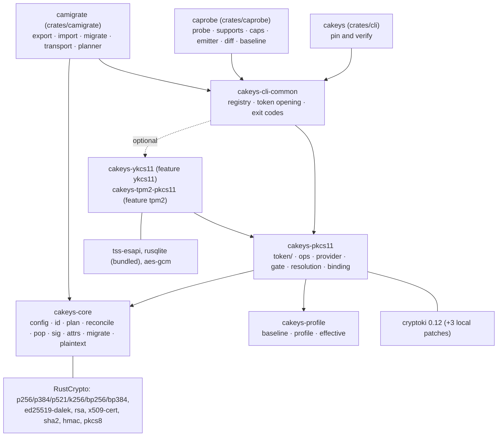
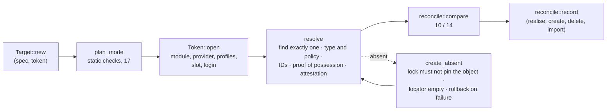

# cakeys: architecture

A map of the repository: where everything lives and how the parts fit. What the identities and
lock rules are is [DESIGN.md](DESIGN.md); each tool's behaviour is in its own document
([CAKEYS.md](CAKEYS.md), [CAPROBE.md](CAPROBE.md), [CAMIGRATE.md](CAMIGRATE.md)).

## Repository map

```text
crates/
  core/         cakeys-core      no token access: config, lock, identity, lock rules, plaintext key parts, the names of moves
  profile/      cakeys-profile   capability profiles as data (no token access)
  pkcs11/       cakeys-pkcs11    cryptoki token layer, verbs, Provider trait, static gate
  ykcs11/       cakeys-ykcs11    YubiKey PIV provider + piv-attestation (pinned Yubico roots)
  tpm2-pkcs11/  cakeys-tpm2-pkcs11  tpm2-pkcs11 provider + native TPM2_Certify attestation, tpm2_ptool import
  cli-common/   cakeys-cli-common  what the binaries share: provider registry, opening tokens, exit codes
  cli/          cakeys           pin and verify; the integration-test harness (tests/common)
  caprobe/      caprobe          the module measurer: probe, supports, caps; profile emitter and diff
  camigrate/    camigrate        the key mover: export, import, migrate, transport; the planner
profiles/       capability profiles: the PKCS#11 3.2 baseline (+ vendored OASIS headers), module
                profiles, layers (cryptoki, p11-kit), hardware (swtpm)
nix/            packages (regular and crane), lib.mkKeys, NixOS module, sandbox hook, VM/module/TPM
                tests, token test environments, demo, fuzz, deny, cryptoki patches
fuzz/           cargo-fuzz targets
examples/       a real YubiKey secure-boot keys.toml and keys.lock
upstream/       PR drafts for rust-cryptoki and tpm2-pkcs11
scripts/        regen-profiles.sh, xversion.sh
docs/           this documentation; docs/archive/ holds dated reviews and working notes
reports/, research_notes/   the lock-format design review and its research
```

Size (2026-11-14): about 19,700 lines of Rust code including tests, 2,900 of Nix and shell, and
1,700 of profile TOML.

## Crates



TPM attestation (`tpm-certify`) stays in `cakeys-tpm2-pkcs11`, behind the `tpm2` feature, and so
with `cakeys`. `cakeys` depends on neither `caprobe` nor `camigrate`, so its build carries no probe or
migration code; `camigrate` records an import through `ops`, the code path `cakeys realise`
uses. `checks.minimal` builds all three without the provider features, and so without tpm2-tss
and sqlite.

| Module | Role |
|---|---|
| `core::config` | `keys.toml` and `keys.lock` types, load and validation, lock invariants, atomic save, the `.lck` advisory lock, `gc` |
| `core::id` | Schemes, canonical SPKI, SRI hashing, commitment inputs, spec digest, attestation encodings |
| `core::plan` | What a (spec, token) pair asks for: identity mode, schemes, binding; static validation (17) |
| `core::reconcile` | The lock rules: `compare` (verdicts, in exit-code order) and `record` (what a write adds) |
| `core::pop`, `core::sig` | Proof-of-possession challenges and host-side verification |
| `core::migrate`, `core::plaintext` | The frozen method and exposure names and the capability model; PKCS#8 into the parts `C_CreateObject` takes |
| `pkcs11::token` | One open token: session, login, SO step, find, policy, generate, identity, possession, host import and extraction, URI |
| `pkcs11::ops` | The verbs: `resolve`, `verify`, `realise`, `create`, `delete`, `check`, and `realise_import` for camigrate |
| `pkcs11::provider` | `Provider` trait, `Registry`, `Generic`; built-ins in `providers` (softhsm, kryoptic, p11-kit) |
| `pkcs11::resolution`, `gate`, `binding` | Which profiles apply to a token, the static `validate` gate, the cryptoki layer |
| `profile` | Profile data model, the embedded set, the effective-support algebra |
| `caprobe` | `probe::generate`, `supports`, the profile emitter, the diff, and the test-only baseline generator |
| `camigrate` | The planner (`plan`), each side's capabilities (`tokens`), and the paths: `public`, `sealed`, `host`, `file`, the bundle and the transport file. The CLI only parses, reads and writes files, and prints |

`cakeys-core` and `cakeys-profile` never touch a token, so the lock rules and the profile
algebra are unit- and property-tested without an HSM.

## Control flow

Every verb is: parse arguments → load `keys.toml` and the lock (taking `<lock>.lck` if the run
writes) → open one token → act → print notes, then the result or the error.



| Verb | Binary | Token | Lock |
|---|---|---|---|
| `validate` | `cakeys` | none | read |
| `resolve`, `verify` | `cakeys` | read | read |
| `check` | `cakeys` | read, or write with `autoCreate` | read |
| `realise`, `create`, `delete` | `cakeys` | write | write (default) |
| `gc` | `cakeys` | none | write with `--apply` |
| `caps`, `supports`, `probe` | `caprobe` | read (`probe --write`: scratch only) | none |
| `export`, `transport` | `camigrate` | read (`transport --trusted`: writes the source as SO) | read |
| `import`, `migrate` | `camigrate` | write the target | write |

## Providers

Module-specific behaviour lives in two places. **Capability profiles** (data,
[CAPROBE.md](CAPROBE.md)) say what a module can do; they filter the mechanism list at token
open and feed `validate`, `supports` and the migration planner. **Providers** (code) rewrite
behaviour or reach outside PKCS#11:

- **Hooks:** `name`, `matches(&ModuleInfo)`, and optionally `mechanisms` (filter) and
  `migration` (both overridden by no in-tree provider today: the capability profiles answer
  them; kept for real-world HSM providers, review A4), `ec_point` (repair), `hint` (error advice), `check_options` (the token's `[tokens.<t>.options]`; the
  default refuses any), `manages_as_so`/`check_create`/`keeps_destroyed_keys` (key
  management on modules that create only as SO or cannot delete keys: ykcs11) and
  `attestation`/`attest` (DESIGN §3.7), `policy_flag` (a misreported attribute: ykcs11's
  `CKA_DERIVE`), `scratch_occupant` (the probe's scratch slot), `import_plaintext` (tpm2-pkcs11's
  `tpm2_ptool` import).
- **Selection:** an explicit `provider` wins; an unknown name is exit 17. Otherwise the first
  registered provider that matches, else `generic` — `provider_is_detected_or_named`, registry unit
  test.
- **The fix-up rule:** a hook must return exactly what a spec-compliant module would, so
  identities are portable. That is also why the provider never takes part in an identity: the
  lock records it only as an observation (`observations.<key>.provider`, DESIGN §4.2), where a change warns.

| Provider | Quirks handled or recorded |
|---|---|
| softhsm | none (reference); attests nothing |
| kryoptic | none to fix (PKCS#11 3.2 reference): Edwards `CKA_EC_POINT` raw (DER with `KRYOPTIC_EC_POINT_ENCODING=DER`; same identity); private keys carry their own `CKA_PUBLIC_KEY_INFO`, so a swapped key is refused (13) by the cross-check before the proof of possession; library version 0.0 in `C_GetInfo`; no secp256k1 or brainpool generation (15); attests nothing |
| ykcs11 | `CKA_PUBLIC_KEY_INFO` length 0 then `CKR_ARGUMENTS_BAD` (tolerated generically); fixed PIV slot IDs and labels: `autoCreate` needs a locator of `CKA_ID` alone naming a key slot (`01`–`04`: 9a/9c/9d/9e, `05`–`18`: 82–95; 17 otherwise) and `mgmKeyFile`/`mgmKeyEnv` (the management key in hex, or the PIN on a PIN-protected-management-key device), since ykcs11 generates only as SO; **keys cannot be deleted** — `C_DestroyObject` clears only the slot's certificate and the key stays, so `delete` (and the cleanup after a failed `realise`) refuses (15), naming `ykman piv keys delete <slot>`; the `piv-attestation` commitment: per-slot attestation certificates found by their label/`CKA_ID`, chain-verified to the embedded Yubico roots (`roots/`, DESIGN §3.7) |
| tpm2-pkcs11 | drops `AES_KEY_GEN`/`GENERIC_SECRET_KEY_GEN` (`C_GenerateKey` unsupported); repairs the malformed P-521 `CKA_EC_POINT` (`04 85 …`; upstream draft in `upstream/tpm2-pkcs11/`) — `tpm2_*` tests; the `tpm-certify` commitment: a native `TPM2_Certify` through tss-esapi and the module's sqlite store (DESIGN §3.7) |
| p11-kit | detects the proxy; the RPC drops AES key wrap and EdDSA/Edwards mechanisms; the module behind it is hidden (set `provider` explicitly) — `p11kit_*` tests; attests nothing itself (what the proxied module exposes decides, but the provider name does not reach it: opt in only against the real module) |

## cryptoki patches

The Nix build patches cryptoki 0.12.1 in `postPatch` (`nix/package-common.nix` lists them, both
the regular and the crane build apply them):

- `cryptoki-hmac-key-types.patch`: cryptoki gives `KeyType::SHA224/384/512_HMAC` the value of
  `CKK_SHA256_HMAC`. Without it those types are refused (`hmac_key_type`), and the binding layer
  subtracts them.
- `cryptoki-aes-key-wrap-kwp.patch`: `CKM_AES_KEY_WRAP_KWP` (kryoptic's RFC 5649 ID).
- `cryptoki-rsa-aes-key-wrap.patch`: `CKM_RSA_AES_KEY_WRAP` and its parameters (`enforced` moves).

The last two add enum variants, so they sit behind camigrate's `kwp` feature: a plain cargo
build plans without them. Upstream drafts: `upstream/rust-cryptoki/`.

## Dependencies

Policy: the latest release of everything, audited on every dependency change against crates.io
and the flake inputs. Pinned on purpose: none, beyond the local patches above. `pkcs12` 0.2 and
`cms` 0.3 are release candidates of the RustCrypto line `der` 0.8 and `x509-cert` 0.3 belong
to. Edition 2024, `rust-version = 1.89`; Nix builds with the nixpkgs rustc. x86_64-linux only.
