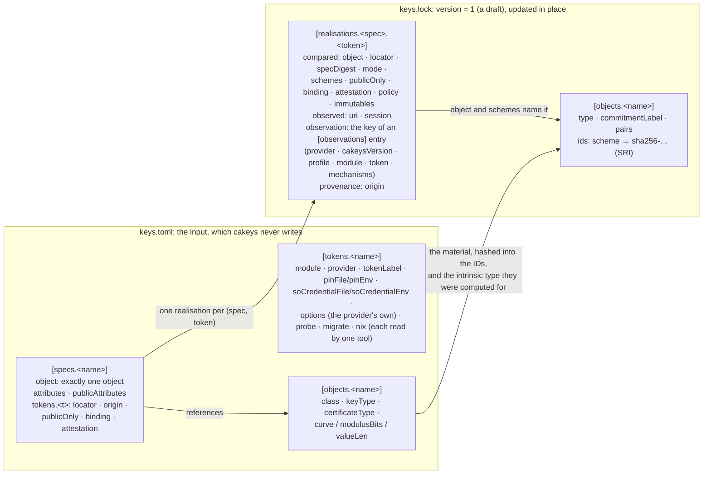
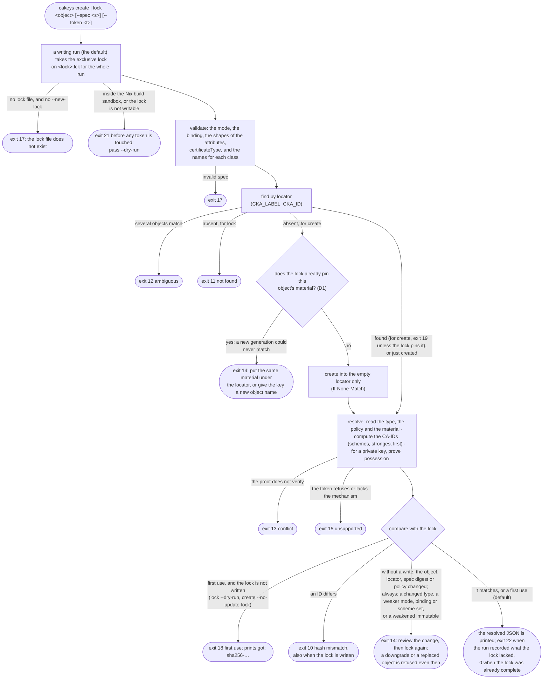
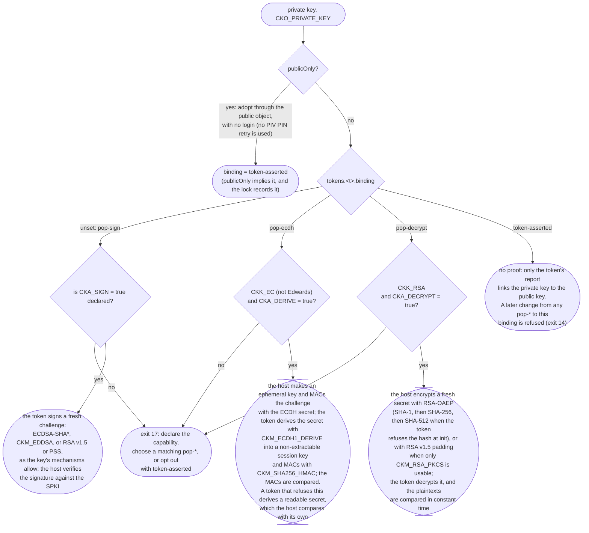
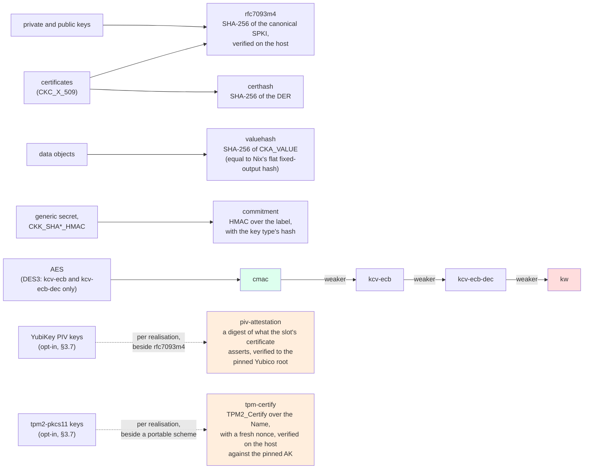
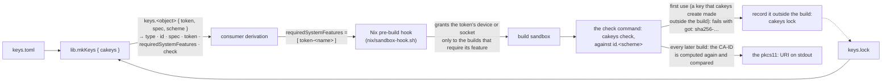

# cakeys in diagrams

This document draws the levels, verbs and rules of [`DESIGN.md`](DESIGN.md) as diagrams. Where
the two documents differ, DESIGN.md is authoritative. All diagrams are
[Mermaid](https://mermaid.js.org) diagrams, which GitHub renders inline.

## 1. The three levels, and the files that hold them

`keys.toml` is the declarative input, and cakeys never writes it. `keys.lock` is the file in
which cakeys records what it found, and cakeys updates it in place. A spec is a policy *about*
an object. A realisation is the record of a spec's object on one token.

- Several specs may share one object, and each of them applies a different policy to the same
  material. A spec has exactly one realisation per token.
- The lock's `ids` record *what the material is*. The realisations record *where the material
  is and under which policy*.
- Each object's entry is self-contained, so lock files can be split and joined per object.
  `pairs` records which objects share a public key (a key and its certificate, or a private and
  a public key object), so that these relations survive a split.

## 2. The steps of a verb: `create` (PUT) and `lock`

Every use computes the identity again from the token and compares it with the lock. Only
`create` makes the object, and only when the locator is empty. `lock` finds the object or exits
with 11. Both verbs record a first use in the lock by default. With `lock --dry-run` or
`create --no-update-lock` (and always in `check`), a first use fails in the way that a
fixed-output derivation fails: the run prints the hash to record.

`check` runs the same steps without the write, in a read-only session, and prints the URI.
Every verb except `validate` and `gc` takes an address that names the object first
(`<object> [--spec] [--token]`). `delete` proves possession again, so that its If-Match
condition cannot pass on an unrelated object that sits under the locator. `gc` prints the lock
entries that the config no longer names and removes them (with `--dry-run`, it only prints
them).

## 3. Proof of possession: which `binding` applies

A private key's identity is the hash of a public key, and that public key may come from a
*separate* object. So every resolve proves again that the private key under the locator belongs
to that public key. It uses whichever capability the key has.

All `pop-*` bindings have the same, highest rank, because each of them proves possession of the
same key. The diagram does not show `pop-unwrap`, which proves possession of an RSA key that may
only unwrap (a transport key, CAMIGRATE.md D3): the host wraps a fresh secret to the public key
with RSA-OAEP, the token unwraps it into a non-extractable session key, and both sides MAC the
challenge with it. A key with `CKA_ALWAYS_AUTHENTICATE` signs after a context-specific login with
the session's PIN, and the lock records `pop-sign-pin` for it ([DESIGN.md](DESIGN.md) §3.6).

## 4. Identity: one object, several schemes

The lock may hold several IDs per object, one per *scheme*, and each ID is an SRI digest. A
scheme never changes once it is defined (§10 of DESIGN): a changed computation gets a new scheme
name. `Scheme::DEPRECATED` lists the deprecated schemes, and it is empty today.

Only the usage attributes that the spec declares decide which commitment schemes run
(`CKA_SIGN` → `cmac`, `CKA_ENCRYPT` → `kcv-ecb`, …). The first scheme computed is the primary
scheme. The lock stores only the SHA-256 of the token's output, never a MAC or a ciphertext
under the key. The attestation schemes (`attestation = true`) record the provenance of the key on
one device, and they are not a portable identity: the same material on another token attests
differently or not at all. So each attestation is recorded on its own realisation, beside a
portable scheme, and the portable scheme is what links the copies on different tokens.

## 5. Usage: the Nix loop

The only tokens that a real build may reach are a p11-kit forwarding socket and a real TPM
(`/dev/tpmrm0`). A build never reaches a token database, because its files would allow offline
PIN guessing.
