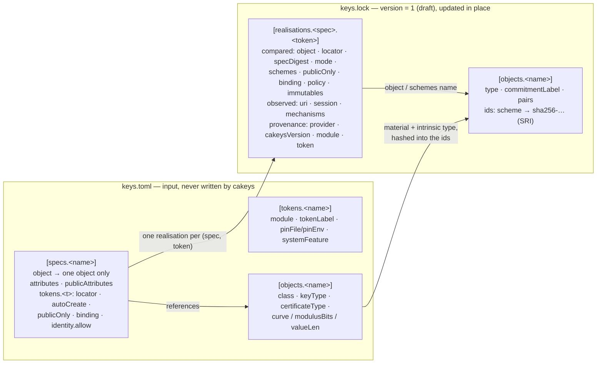
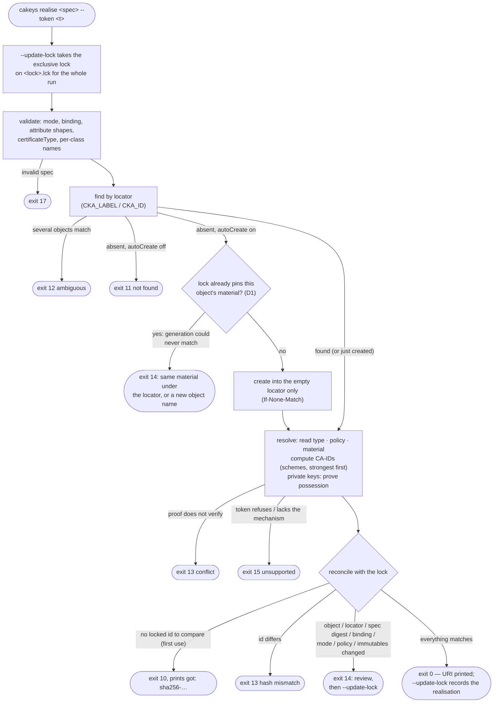
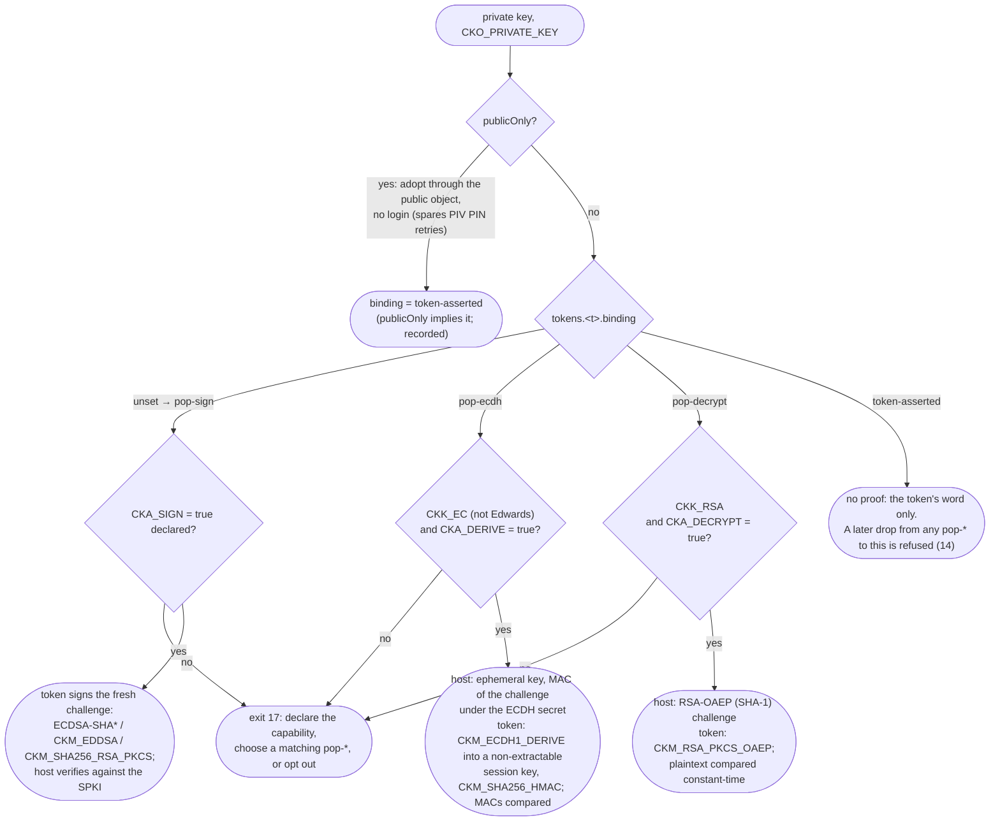
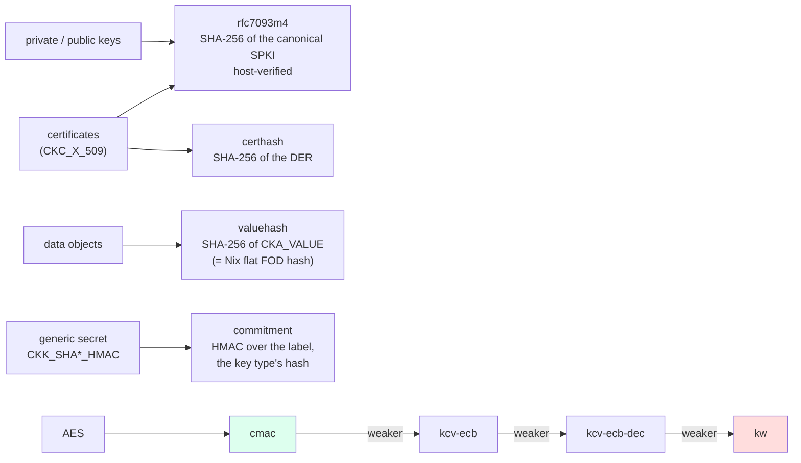
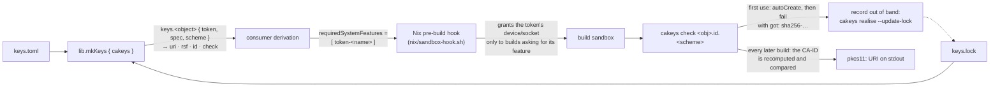

# cakeys at a glance

Visual companions to [`DESIGN.md`](DESIGN.md), which stays authoritative: the same levels,
verbs and rules, drawn. All diagrams are [Mermaid](https://mermaid.js.org) (GitHub renders them
inline).

## 1. The three levels, and where they live

`keys.toml` is the declarative input; `keys.lock` is what cakeys records and updates in place.
A spec is policy *about* an object; a realisation is one object's life on one token.

- Several specs may share one object (different policy over the same material); one spec has
  exactly one realisation per token.
- The lock's `ids` answer *what the material is*; the realisations answer *where it lives and
  under which policy*.
- Objects are self-contained, so lock files split and join per object; `pairs` records the
  key ↔ certificate relations across the split.

## 2. A verb's life: `realise` (PUT)

Every use recomputes the identity from the token and compares it with the lock. First use fails
like a fixed-output derivation: record the printed hash out of band.

`verify` is the same walk without the create; `check` is `realise` that never writes the lock;
`delete` proves possession once more so If-Match cannot pass on a bystander object; `gc` prints
lock entries the config no longer names and removes them with `--apply`.

## 3. Proof of possession: which `binding` applies

A private key's identity hashes a public key that may come from a *separate* object, so every
resolve re-proves that the private key under the locator belongs to that public key — with
whichever capability the key has.

All `pop-*` share the top binding rank: each proves possession of the same key. A key carrying
`CKA_ALWAYS_AUTHENTICATE` is refused at run time (16) — a proof would spend a PIN entry per run.

## 4. Identity: one object, several schemes

The lock may hold several ids per object — one per *scheme*, each an SRI digest. A scheme is
frozen forever (§10 of DESIGN): a changed computation gets a new name, and `DEPRECATED_SCHEMES`
(empty today) is the deprecation register.

Only the declared usage bits decide which commitment schemes run (CKA_SIGN → cmac,
CKA_ENCRYPT → kcv-ecb, …); the first computed is the primary scheme, and the lock stores only
SHA-256 of the token's output, never a MAC or ciphertext under the key.

## 5. Usage: the Nix loop

The token a real build may reach is a p11-kit forwarding socket or a real TPM (`/dev/tpmrm0`) —
never a token database, whose files would allow offline PIN guessing.
